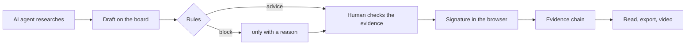

<p align="center">
  <picture>
    <source media="(prefers-color-scheme: dark)" srcset="docs/bilder/readme/wortmarke-dunkel.svg">
    
  </picture>
</p>

<p align="center"><b>An investigator's evidence board with mandatory sources and a signed evidence chain – built for research with AI agents.</b></p>

<p align="center">
  <a href="https://github.com/ThePyth0nKid/ultra-akte/releases"></a>
  <a href="LICENSE"></a>
  <a href="https://github.com/ThePyth0nKid/ultra-akte/actions/workflows/ci.yml"></a>
  <a href="https://github.com/ThePyth0nKid/ultra-akte/actions/workflows/leckschutz.yml"></a>
  <a href="REUSE.toml"></a>
  
</p>

<p align="center">
  <a href="README.md">Deutsch</a> · <b>English</b> · <a href="#quick-start-in-three-steps-windows">Quick start</a> · <a href="#what-it-does">What it does</a> · <a href="#for-ai-agents">For AI agents</a>
</p>

<picture>
  <source media="(prefers-color-scheme: dark)" srcset="docs/bilder/readme/kopf-dunkel.webp">
  
</picture>
<p align="center"><sub>Everything is invented: the demo “Freie Stadt Musterhafen”. The photos are AI images and labelled as such on every card.</sub></p>

Ultra-Akte (“Akte” is German for a case file) is an investigator's evidence board that runs on your own computer: cards for people,
companies, authorities and laws, connected by threads. Every thread needs evidence: a source with a verbatim quote.
AI agents such as Claude Code research and create drafts; readers only see what a human has checked and signed.

*Agents research, rules advise, the human decides and signs.*

The interface and the full documentation are in German; this page is the English overview, and the screenshots
show the German interface. The step-by-step guide for agents is [AGENTS.md](AGENTS.md) (German, commands identical).

<picture>
  <source media="(prefers-reduced-motion: reduce)" srcset="docs/bilder/readme/fahrt-standbild.webp">
  
</picture>
<p align="center"><sub>A camera flight, rendered frame by frame from the board. The same flight can become a video with voice and music.</sub></p>


## How a piece of research flows

An agent creates cards, threads and sources, but cannot release anything. The check reports what is missing, and a
block holds a thread back until a human overrides it with a reason. Only the signature turns a draft into
something readers see.



**Windows, macOS and Linux.** Ultra-Akte runs on all three, and we want everything to work on all three. The quick
start below shows Windows; the same path for Mac and Linux is in
[Erste Schritte](docs/erste-schritte.md#mac-und-linux) (German). CI checks the starters on Windows, macOS and Linux
with every change. If something does not work for you, please open an
[issue](https://github.com/ThePyth0nKid/ultra-akte/issues).

## Quick start in three steps (Windows)

You need Windows 10 or 11, about 10 GB of free disk space, internet access and a Claude subscription (Pro or Max).

1. **Install Claude Code.** Press the Windows key, type `PowerShell`, press Enter, then run:

   ```
   irm https://claude.ai/install.ps1 | iex
   ```

   If it reports `…\.local\bin is not in your PATH`, run this line and open a new PowerShell window:

   ```
   [Environment]::SetEnvironmentVariable('Path', [Environment]::GetEnvironmentVariable('Path','User') + ';' + $env:USERPROFILE + '\.local\bin', 'User')
   ```

2. **Create a working folder and start Claude** (so Claude only sees this folder):

   ```
   mkdir -Force $HOME\Recherche; cd $HOME\Recherche; claude
   ```

3. **Tell Claude:**

   > Set up Ultra-Akte for me. Instructions: https://github.com/ThePyth0nKid/ultra-akte

   Claude downloads the release, starts it and connects itself. You click “Yes” when Windows asks, restart once if
   Docker is new, and create your account in the browser; the starter opens that page with your setup code already
   filled in (Claude never sees the code). Expect 20 to 40 minutes, mostly waiting.

## For AI agents

Follow [AGENTS.md](AGENTS.md) step by step (raw text: `curl.exe -fsSL https://raw.githubusercontent.com/ThePyth0nKid/ultra-akte/v0.3.0/AGENTS.md`).
In short, on Windows (PowerShell):

1. Check Docker; if missing, ask your human, then `winget install -e --id Docker.DockerDesktop --accept-source-agreements --accept-package-agreements`.
   The human picks “All-users installation” if asked, restarts, presses a key in the WSL window, clicks “Accept”
   if Docker shows an agreement, and resumes with `claude --continue`.
2. If `$env:USERPROFILE\Akte\compose.yaml` is missing: download
   `https://github.com/ThePyth0nKid/ultra-akte/archive/refs/tags/v0.3.0.zip`, extract it and copy the contents of the
   inner folder `ultra-akte-…` into `$env:USERPROFILE\Akte` (an empty `Akte` folder is fine; if it holds anything
   else, ask your human first).
3. `powershell -NoProfile -ExecutionPolicy Bypass -File "$env:USERPROFILE\Akte\start\akte.ps1" start -Still` (allow 10 minutes).
4. `start` opens the browser on the first-account page with the setup code already filled in (it travels only in
   the URL fragment `#code=…`). `… akte.ps1 status -Json` returns
   `{"docker":"fehlt|aus|laeuft","akte":"aus|laeuft","url":…,"einrichtung_offen":bool,"einrichtung_grund":"offen|kein_code|eingerichtet"|null,"agent_verbunden":bool}`
   and never the code. While `einrichtung_offen` is true, tell the human the `url`; the human creates the account.
   If the page was closed, run `start -Still` again (or the human double-clicks `start\START-AKTE.cmd`); it reopens
   the page with the code. No console ever shows the code. If no browser opens at all, the human uses the fallback
   without a code: `cd "$env:USERPROFILE\Akte"; docker compose exec api python manage.py akte_einrichten` (asks for
   name and password). You never read `.env`, never ask for the code and never type or ask for passwords.
5. `… akte.ps1 agent -Still` installs uv if needed, fetches the token without printing it and runs
   `claude mcp add --scope user akte … -- uvx --python 3.12 --from "…/v0.3.0.zip#subdirectory=mcp" akte-mcp`.
6. The human restarts Claude: `/exit`, then `claude --continue`. If `/mcp` then shows `akte` with ✗, the human
   selects `akte` and “Reconnect” (the very first start can take longer than Claude waits).

Rules: never handle passwords, never read `.env` or ask for the setup code, never print the token, ask before
installing anything, and write everything the human reads in the human's language. You cannot release or sign
anything; only a human can, in the browser. macOS and Linux:
`bash ~/Akte/start/akte.sh start --still` and the same commands with `--json`, `--still`.

## Manual start

Install Docker Desktop (choose “All-users installation”), download the release ZIP
(https://github.com/ThePyth0nKid/ultra-akte/releases/tag/v0.3.0), extract it, then double-click
`start\START-AKTE.cmd`. The starter waits for Docker, builds the app and opens
http://localhost:8080/akte/einrichten with your setup code filled in (no console shows the code). After the first
account exists, the starter deletes the code from `.env`. `start\AGENT-VERBINDEN.cmd` connects Claude Code.
macOS/Linux: `bash start/akte.sh start`.

## What it costs

Ultra-Akte and uv are free. Docker Desktop is free for personal use, education, non-commercial open source and small
businesses. Claude Code needs a paid Claude plan (Pro or Max) or Anthropic API credit. No extra search services are
needed.

## What leaves your computer

Your prompts and everything Claude reads from the board go to Anthropic. Every source URL is fetched from your own
connection (the site sees your IP address). Source URLs go to archive.org only if a human turns that on (off by
default). Database, preserved copies, password and signing key stay on your machine; the app only listens on
`127.0.0.1` and only answers to the host names in `AKTE_HOSTS` (default `localhost 127.0.0.1 ::1 [::1]`).

## What it does


**Cards with an image where it fits.** Every image carries a credit line on the card: author and licence, or in the
demo “KI-Bild · erfundene Person” (AI image, invented person). Logos and coats of arms are shown whole on a light
background. Private persons get no photo; readers only see their initials.


**Three kinds of threads.** A thread is a claim with a type, a time span and at least one piece of evidence. For a
suspicion against a person the check reports a missing hearing or a missing second independent source; against a
private person it blocks the thread completely.


**Every quote is checked against the preserved copy** (or the original if there is none). If the quote is there,
Ultra-Akte highlights it. If it differs,
it reports “nicht_gefunden” (not found), to the agent as well. The demo contains one deliberately misquoted line.


**Rules advise, you decide.** Each rule can be set per board to *off*, *advice* or *block*. A block keeps a thread
out of the reader view until you override it with a reason when you sign.

<picture>
  <source media="(prefers-reduced-motion: reduce)" srcset="docs/bilder/readme/live-standbild.webp">
  
</picture>

**Live on the board.** What an agent creates appears on the open board within seconds, as a draft stamped “neu”.

<sub>Every screenshot and animation on this page is generated from the demo by [`werkzeuge/readme_bilder`](werkzeuge/readme_bilder/README.md).</sub>

### Under the hood

1. **Rules in the data model.** A thread between two cards is a claim with a type, time span, statement kind
   (*sourced*, *suspicion*, *opinion*) and evidence: source, **verbatim quote** and location. A check reports what is
   missing; every rule can be set to *off*, *advice* or *block*.
2. **Evidence layer.** Every source is preserved (original with SHA-256, optional archive copy, page image, the
   highlighted quote location). Every preservation and every release becomes a signed link in a hash chain in the
   [`atlas-trace-v1`](https://github.com/ThePyth0nKid/atlas) format (Ed25519, BLAKE3, canonical CBOR). Anyone can
   verify it without trusting the server.
3. **Output layer.** Deterministic camera flights over the board, rendered frame by frame to video.

Agents (tool tokens, MCP) cannot release, delete or publish anything. Releasing means signing in the browser with a
non-extractable WebCrypto Ed25519 key.

## Claude Code (MCP), by hand

Easier: `start\AGENT-VERBINDEN.cmd`, which also uses the right port. By hand, in the Akte folder; `8080` is the
default port, a different one is in `.env` as `AKTE_PORT`:

```
docker compose exec api python manage.py akte_token YOUR-ACCOUNT
```

```
claude mcp add --scope user akte -e AKTE_BASIS=http://127.0.0.1:8080 -e AKTE_TOKEN=YOUR-TOKEN -- uvx --python 3.12 --from "https://github.com/ThePyth0nKid/ultra-akte/archive/refs/tags/v0.3.0.zip#subdirectory=mcp" akte-mcp
```

## Verify the evidence chain

```
uv tool install --python 3.12 "akte-mcp[beweis] @ https://github.com/ThePyth0nKid/ultra-akte/archive/refs/tags/v0.3.0.zip#subdirectory=mcp"
```

```
akte pruefe-signaturen --basis http://localhost:8080 --atlas
```

A valid chain proves integrity, authorship by a human key and binding to the exact content – not truth, not the real
identity behind a key, and (until anchoring lands) not the time against a backdating operator. See
[docs/sicherheit.md](docs/sicherheit.md).

<picture>
  <source media="(prefers-reduced-motion: reduce)" srcset="docs/bilder/readme/terminal-standbild.webp">
  
</picture>


## License

AGPL-3.0-or-later for the program (`backend/`, `web/`, `render/`, `start/`); MIT for `mcp/`, `beweis/`, `skills/`,
`werkzeuge/`; CC BY 4.0 for `docs/` and `AGENTS.md`. See `REUSE.toml`. Ultra-Akte does not replace legal review.
