<p align="center">
  <picture>
    <source media="(prefers-color-scheme: dark)" srcset="docs/bilder/readme/wortmarke-dunkel.svg">
    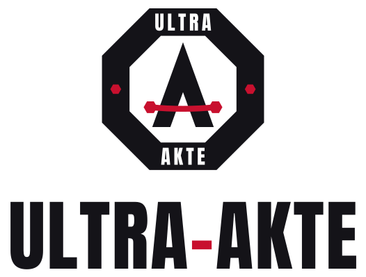
  </picture>
</p>

<p align="center"><b>Eine Ermittler-Wand mit Belegpflicht und Beweiskette – gebaut für Recherche mit KI-Agenten.</b></p>

<p align="center">
  <a href="https://github.com/ThePyth0nKid/ultra-akte/releases"></a>
  <a href="LICENSE"></a>
  <a href="https://github.com/ThePyth0nKid/ultra-akte/actions/workflows/ci.yml"></a>
  <a href="https://github.com/ThePyth0nKid/ultra-akte/actions/workflows/leckschutz.yml"></a>
  <a href="REUSE.toml"></a>
  
</p>

<p align="center">
  <b>Deutsch</b> · <a href="README.en.md">English</a> · <a href="#schnellstart-in-drei-schritten-windows">Schnellstart</a> · <a href="#was-die-akte-kann">Was sie kann</a> · <a href="#für-ki-agenten-so-richtest-du-die-akte-für-deinen-menschen-ein">Für KI-Agenten</a> · <a href="AGENTS.md">AGENTS.md</a> · <a href="docs/erste-schritte.md">Erste Schritte</a>
</p>

<picture>
  <source media="(prefers-color-scheme: dark)" srcset="docs/bilder/readme/kopf-dunkel.webp">
  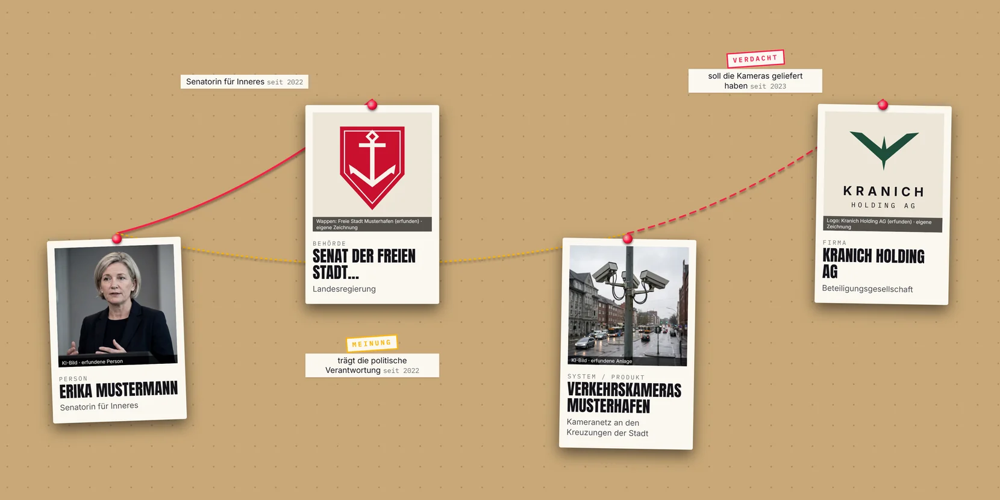
</picture>
<p align="center"><sub>Alles erfunden: die Demo „Freie Stadt Musterhafen“. Die Fotos sind KI-Bilder und auf jeder Karte so gekennzeichnet.</sub></p>

Die Ultra-Akte ist eine Ermittler-Wand für deinen eigenen Rechner: Karten für Personen, Firmen, Behörden und Gesetze,
verbunden durch Fäden. Jeder Faden braucht einen Beleg, also eine Quelle mit wörtlichem Zitat. KI-Agenten wie
Claude Code recherchieren und legen Entwürfe an; sichtbar wird nur, was ein Mensch geprüft und mit seiner
Unterschrift freigegeben hat.

*Agenten recherchieren, Regeln beraten, der Mensch entscheidet und unterschreibt.*

<picture>
  <source media="(prefers-reduced-motion: reduce)" srcset="docs/bilder/readme/fahrt-standbild.webp">
  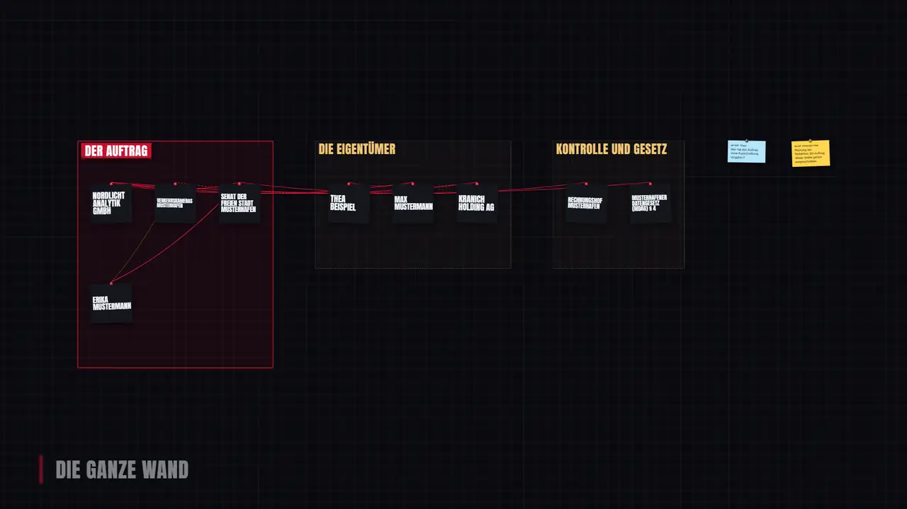
</picture>
<p align="center"><sub>Eine Kamerafahrt, Bild für Bild aus der Akte gerendert. Dieselbe Fahrt wird auf Wunsch ein Video mit Stimme und Musik.</sub></p>

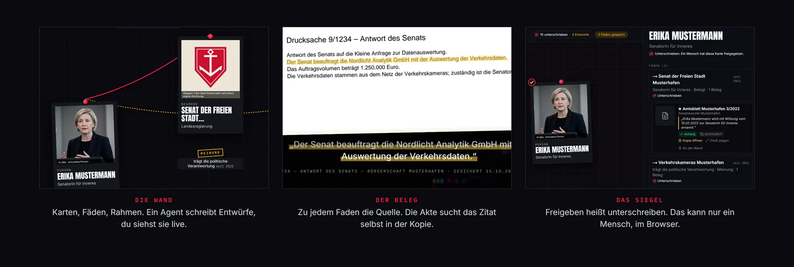

## So läuft eine Recherche

Ein Agent legt Karten, Fäden und Quellen an, freigeben kann er nichts. Die Prüfung meldet, was fehlt, und eine
Sperre hält einen Faden auf, bis ein Mensch sie mit Begründung überstimmt. Erst die Unterschrift macht aus einem
Entwurf etwas, das Leser sehen.

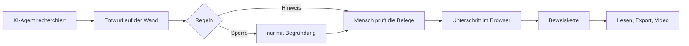

**Windows, macOS und Linux.** Die Akte läuft auf allen drei Systemen, und wir wollen, dass alles auf allen dreien
geht. Der Schnellstart unten zeigt Windows; derselbe Weg für Mac und Linux steht in
[Erste Schritte](docs/erste-schritte.md#mac-und-linux). Die Starter prüft die CI bei jeder Änderung unter Windows,
macOS und Linux. Klappt bei dir etwas nicht, schreib es in ein
[Issue](https://github.com/ThePyth0nKid/ultra-akte/issues). Neu bei Terminal und KI?
[Erste Schritte mit Bildern](docs/erste-schritte.md) und [Fachwörter erklärt](docs/woerter.md).

---

## Schnellstart in drei Schritten (Windows)

Du brauchst Windows 10 oder 11, rund 10 GB freien Platz, Internet und ein Claude-Abo (Pro oder Max).

1. **Claude Code installieren.** Drück die Windows-Taste, tippe `PowerShell` und drück Enter. Im blauen Fenster
   gibst du ein:

   ```
   irm https://claude.ai/install.ps1 | iex
   ```

   Steht danach `…\.local\bin is not in your PATH`, gib diese Zeile ein und öffne dann ein neues PowerShell-Fenster:

   ```
   [Environment]::SetEnvironmentVariable('Path', [Environment]::GetEnvironmentVariable('Path','User') + ';' + $env:USERPROFILE + '\.local\bin', 'User')
   ```

2. **Eigenen Ordner anlegen und Claude starten.** So arbeitet Claude nur in diesem Ordner und nicht in deinem
   ganzen Benutzerordner:

   ```
   mkdir -Force $HOME\Recherche; cd $HOME\Recherche; claude
   ```

   Melde dich mit deinem Claude-Konto an und bestätige, dass du dem Ordner vertraust.

3. **Sag zu Claude:**

   > Richte mir die Ultra-Akte ein. Die Anleitung steht hier: https://github.com/ThePyth0nKid/ultra-akte

   Claude lädt die Akte, startet sie und verbindet sich mit ihr. Drei Dinge machst du selbst: bei Fragen von
   Windows auf „Ja“ klicken, den PC einmal neu starten (nur wenn Docker neu ist) und im Browser dein Konto anlegen.
   Rechne mit 20 bis 40 Minuten. Das meiste davon ist Warten.

Mac und Linux: [docs/erste-schritte.md](docs/erste-schritte.md#mac-und-linux). Ohne Agent geht es auch:
[Von Hand starten](#von-hand-starten-doppelklick).

---

<!-- agenten-anleitung:anfang (wörtlich gleich in AGENTS.md; die CI vergleicht beide) -->
## Für KI-Agenten: so richtest du die Akte für deinen Menschen ein

> **An den Agenten:** Dein Mensch hat dich gebeten, die Akte einzurichten. Folge diesen Schritten der Reihe nach.
> Hast du diese Seite mit einem Werkzeug gelesen, das Seiten zusammenfasst, hol dir zuerst den Wortlaut, denn die
> Befehle müssen genau so laufen:
> `curl.exe -fsSL https://raw.githubusercontent.com/ThePyth0nKid/ultra-akte/v0.3.0/AGENTS.md`
> (macOS und Linux: `curl -fsSL …` mit derselben Adresse).

### Regeln, die immer gelten

1. **Keine Passwörter.** Du tippst nie ein Passwort und fragst nie danach. Das erste Konto legt dein Mensch im
   Browser an.
2. **Den Einrichtungscode kennst du nicht.** Mit ihm legt dein Mensch das erste Konto an. Der Starter öffnet damit
   selbst den Browser, der Code ist dort schon eingetragen. In keiner Ausgabe für dich steht er. Lies nie die Datei
   `.env` und frag nie nach dem Code. Leg auch nie selbst ein Konto an, auch nicht über `docker compose exec`.
3. **Nichts freigeben.** Alles, was du in der Akte anlegst, ist ein Entwurf. Freigeben und Unterschreiben tut ein
   Mensch im Browser. Dafür gibt es bewusst kein Werkzeug.
4. **Den Token nie zeigen.** Der Token ist der Schlüssel für deine Verbindung zur Akte. Der Starter holt ihn und
   trägt ihn selbst ein; du gibst ihn nie aus.
5. **Erst fragen, dann installieren.** Bevor du etwas installierst, sagst du deinem Menschen, was passiert, und
   wartest auf sein Ja.
6. **Zeit lassen.** Start und Verbinden dauern beim ersten Mal mehrere Minuten. Gib diesen Befehlen 10 Minuten
   (Claude Code: `timeout` 600000) oder starte sie im Hintergrund und frag danach mit `status -Json` ab. Bricht ein
   Befehl wegen der Zeit ab, ruf ihn noch einmal auf; Docker macht dort weiter, wo es war.
7. **In der Sprache deines Menschen.** Alles, was er liest, schreibst du in seiner Sprache, auch die kurzen Sätze
   zwischen zwei Befehlen. Schreibt er deutsch, schreibst du deutsch.

Unter Windows sind alle Befehle für PowerShell geschrieben. Hast du nur eine Bash (Git Bash), setz
`powershell -NoProfile -Command '…'` um den Befehl.

### Schritt 1: Docker prüfen

```
if ((Get-Command docker -ErrorAction SilentlyContinue) -or (Test-Path "$env:ProgramFiles\Docker\Docker\Docker Desktop.exe")) { "Docker ist da" } else { "Docker fehlt" }
```

Ist Docker da, weiter mit Schritt 2. Fehlt Docker, sag deinem Menschen:

> Die Akte läuft in Docker, und das fehlt noch. Ich installiere jetzt Docker Desktop (für Privatleute kostenlos).
> Windows fragt dich gleich, ob du Änderungen zulassen willst: Klick auf „Ja“. Fragt ein Docker-Fenster nach
> „Per-user“ oder „All-users“, wähl „All-users installation“. Einverstanden?

Nach dem Ja:

```
winget install -e --id Docker.DockerDesktop --accept-source-agreements --accept-package-agreements
```

Danach braucht Windows einen Neustart. Sag deinem Menschen vorher genau das (für ORDNER setzt du deinen
aktuellen Arbeitsordner ein):

> Starte jetzt den PC neu. Nach dem Neustart: Will ein schwarzes Fenster „Windows-Subsystem für Linux …“ eine
> Taste, drück sofort eine Taste. Meldet Docker danach „WSL not installed“, klickst du „Quit“: Das ist normal, ich
> starte Docker später selbst. Zeigt Docker einen Vertrag, klickst du „Accept“; anmelden musst du dich bei Docker
> nicht.
> Dann öffnest du PowerShell, tippst `cd ORDNER` und danach `claude --continue`. Dann mache ich weiter.

### Schritt 2: Die Akte holen

```
if (Test-Path "$env:USERPROFILE\Akte\compose.yaml") { "Akte ist da" } elseif ((Test-Path "$env:USERPROFILE\Akte") -and (Get-ChildItem -Force "$env:USERPROFILE\Akte")) { "Ordner Akte ist belegt" } else { "Akte fehlt" }
```

* `Akte ist da`: weiter mit Schritt 3.
* `Ordner Akte ist belegt`: Im Benutzerordner gibt es schon einen Ordner `Akte` mit anderem Inhalt. Frag deinen
  Menschen, was damit passieren soll. Verschieb und lösch dort nichts ohne sein Ja.
* `Akte fehlt`: Lade die Version 0.3.0 mit diesen drei Befehlen nacheinander (kein Git nötig; ein leerer Ordner
  `Akte` stört nicht):

```
$ProgressPreference = "SilentlyContinue"; Invoke-WebRequest -UseBasicParsing "https://github.com/ThePyth0nKid/ultra-akte/archive/refs/tags/v0.3.0.zip" -OutFile "$env:TEMP\ultra-akte-0.3.0.zip"
```

```
$ProgressPreference = "SilentlyContinue"; Remove-Item "$env:TEMP\ultra-akte-0.3.0" -Recurse -Force -ErrorAction SilentlyContinue; Expand-Archive "$env:TEMP\ultra-akte-0.3.0.zip" -DestinationPath "$env:TEMP\ultra-akte-0.3.0" -Force
```

```
New-Item -ItemType Directory -Force "$env:USERPROFILE\Akte" | Out-Null; Copy-Item "$env:TEMP\ultra-akte-0.3.0\*-akte-*\*" "$env:USERPROFILE\Akte" -Recurse -Force
```

### Schritt 3: Die Akte starten

Liest du vorher eine Datei im Ordner `Akte` (nur `start\akte.ps1`, nie `.env`), fragt Claude Code deinen Menschen
vielleicht auf Englisch: „Read outside the working directories … Allow this read?“ Sag ihm vorher: „Gleich fragt
Claude Code auf Englisch, ob ich im Ordner Akte lesen darf. Wähl mit den Pfeiltasten die Antwort, die es nur dieses
eine Mal erlaubt (Yes, but ask again next time), und drück Enter. Nimm nicht die Antwort mit keep allowing, die
erlaubt es dauerhaft.“ Mit „No“ liest du die Datei nicht; der Start geht trotzdem.

```
powershell -NoProfile -ExecutionPolicy Bypass -File "$env:USERPROFILE\Akte\start\akte.ps1" start -Still
```

Der Starter startet Docker Desktop, falls es noch nicht läuft, wartet bis zu 3 Minuten darauf, legt die Datei
`.env` mit einem geheimen Schlüssel und dem Einrichtungscode an und baut die Akte. Beim ersten Mal dauert das 3 bis
10 Minuten. Zum Schluss öffnet er den Browser auf der Seite „Erstes Konto anlegen“, den Einrichtungscode schon
eingetragen, und schreibt: „Der Browser ist offen: wähl dort Name und Passwort.“ Rückgabewert 0 heißt: Sie läuft.
Alle anderen Werte stehen in der Tabelle [Wenn etwas schiefgeht](#wenn-etwas-schiefgeht).

### Schritt 4: Dein Mensch legt das erste Konto an

```
powershell -NoProfile -ExecutionPolicy Bypass -File "$env:USERPROFILE\Akte\start\akte.ps1" status -Json
```

Die Antwort ist eine Zeile JSON, zum Beispiel:

```
{"docker":"laeuft","akte":"laeuft","url":"http://localhost:8080/akte/einrichten","einrichtung_offen":true,"einrichtung_grund":"offen","agent_verbunden":false}
```

Ist `einrichtung_offen` gleich `true`, sag deinem Menschen (mit `url` aus der Antwort):

> Die Akte läuft. Im Browser ist die Seite „Erstes Konto anlegen“ offen (http://localhost:8080/akte/einrichten),
> der Einrichtungscode ist dort schon eingetragen. Wähl einen Benutzernamen und ein Passwort mit mindestens 10
> Zeichen; das Passwort erfahre ich nicht. Die Frage nach archive.org kannst du auf „Nein“ lassen: Dann landet keine
> Adresse deiner Quellen öffentlich bei archive.org. Ist keine Seite offen oder das Feld für den Code leer: Öffne im
> Explorer deinen Benutzerordner, dann `Akte` und `start`, und doppelklick `START-AKTE`. Der Starter öffnet die
> Seite neu, mit dem Code. Sag mir Bescheid, wenn du fertig bist.

Hat dein Mensch die Seite nur geschlossen, ruf `start -Still` noch einmal auf; der Starter öffnet sie wieder. Den
Code zeigt keine Konsole an, auch nicht das Fenster von `START-AKTE`.

Warte auf die Antwort. Frag dann `status -Json` noch einmal ab. Jetzt muss `einrichtung_offen` gleich `false` und
`einrichtung_grund` gleich `eingerichtet` sein. Steht dort `kein_code` (Daten aus einer früheren Installation, aber
noch kein Konto) oder geht bei deinem Menschen gar kein Browser auf, nimmt er den Notweg: Er legt das Konto selbst im
Terminal an, ohne Code; das Programm fragt nach Benutzername und Passwort, und das Passwort sieht beim Tippen
niemand. Sag ihm: PowerShell öffnen und diese Zeile eingeben:

```
cd "$env:USERPROFILE\Akte"; docker compose exec api python manage.py akte_einrichten
```

### Schritt 5: Dich mit der Akte verbinden

```
powershell -NoProfile -ExecutionPolicy Bypass -File "$env:USERPROFILE\Akte\start\akte.ps1" agent -Still
```

Der Starter installiert bei Bedarf uv in einer festen Version (offizieller Installer von astral.sh, Prüfsumme
geprüft), trägt `%USERPROFILE%\.local\bin` dauerhaft in den Pfad ein, holt den Token, ersetzt einen alten Eintrag
`akte` und trägt die Akte bei Claude Code ein:
`claude mcp add --scope user akte … -- uvx --python 3.12 --from "…/v0.3.0.zip#subdirectory=mcp" akte-mcp`.
Danach lädt er den Akte-Baustein einmal vor. Gibt es mehrere Konten, meldet er Rückgabewert 9; frag deinen
Menschen, welches Konto du benutzen sollst, und häng `-Konto NAME` an.

### Schritt 6: Claude neu starten

Die Werkzeuge der Akte siehst du erst nach einem Neustart von Claude Code. Sag deinem Menschen den Schlusssatz des
Starters:

> Fertig. Beende Claude (/exit) und starte es neu mit: claude --continue

Meldet der Starter, dass er den Pfad neu eingetragen hat, gehört dazu: in einem neuen Terminal-Fenster, im selben
Ordner (`cd ORDNER`). Nach dem Neustart zeigt `/mcp` den Eintrag `akte` als verbunden. Fehlen dir danach die
Werkzeuge der Akte oder steht in `/mcp` bei `akte` ein ✗, sag deinem Menschen: „Tipp `/mcp`, wähl `akte` und dann
`Reconnect`.“ Beim allerersten Start braucht der Baustein manchmal länger, als Claude wartet.

### Schritt 7: Erster Auftrag

Prüf mit dem Werkzeug `boards_liste`, ob die Verbindung steht. Dann schlag deinem Menschen vor:

1. Die erfundene Demo-Akte laden:

   ```
   powershell -NoProfile -ExecutionPolicy Bypass -File "$env:USERPROFILE\Akte\start\akte.ps1" demo -Still
   ```

2. Den ersten Auftrag: „Lies die Wand demo-musterhafen und sag mir, welche Fäden noch offene Befunde haben.“
3. Erklär dabei: Du legst nur Entwürfe an. Freigeben tut dein Mensch im Browser mit „Freigeben (unterschreiben)“.

Für eine eigene Recherche: Such zusätzlich zum Schlagwort der Debatte immer nach der amtlichen Bezeichnung
(Gesetzestitel, Aktenzeichen, Fachbegriff), und such nach beiden Seiten, Befürwortern und Gegnern. Im ersten
echten Test fand die Suche nach „Chatkontrolle“ im Lobbyregister nur Gegner; die Befürworter standen unter der
amtlichen Bezeichnung der EU-Verordnung. Schreib einen Negativbefund deshalb nur mit den Suchwörtern, die du
benutzt hast („Mit A, B und C fand ich keinen Eintrag“).

Stellungnahmen und Gutachten im Lobbyregister öffnen sich erst nach einem Klick auf einen Hinweis zum Urheberrecht;
die Akte sichert dann nur diese Hinweisseite, und `zitat_pruefen` findet das Zitat nicht. Bitte deinen Menschen,
die PDF im Browser zu öffnen und am Faden auf „PDF oder Screenshot hierher ziehen“ abzulegen; danach prüfst du das
Zitat noch einmal. Die Detailansicht eines Registereintrags (PDF) sichert die Akte ohne diesen Umweg.

### Wenn etwas schiefgeht

Rückgabewerte von `akte.ps1` (unter macOS und Linux gleich bei `akte.sh`):

| Wert | Bedeutung | Was du tust |
|---|---|---|
| 0 | fertig | weiter |
| 1 | unerwarteter Fehler; mit `-Json` kommt `{"fehler": "…"}` | Meldung lesen, deinem Menschen zeigen |
| 2 | nicht entpackt, `compose.yaml` fehlt | Schritt 2 wiederholen |
| 3 | Docker fehlt | Schritt 1 |
| 4 | Docker startet nicht (3 Minuten gewartet) | Mensch öffnet Docker Desktop und schaut, ob es etwas fragt („Accept“, WSL-Fenster: Taste). Meldet Docker „WSL not installed“ direkt nach der Installation: Docker Desktop beenden, eine Minute warten, neu öffnen; sonst PC neu starten. Dann Schritt 3 |
| 5 | Port belegt und mit `AKTE_PORT` fest eingestellt | Umgebungsvariable `AKTE_PORT` entfernen oder einen freien Port setzen (ohne sie sucht der Starter selbst einen) |
| 6 | Bau, Start oder Demo fehlgeschlagen | Die letzten Zeilen lesen. Häufig: kein Internet, zu wenig Platz (10 GB). Ganzes Protokoll: `$env:TEMP\die-akte-start.log` |
| 7 | Claude Code nicht gefunden | Mensch installiert es wie im Schnellstart, Schritt 1 |
| 8 | uv ließ sich nicht installieren | Internet prüfen, Schritt 5 wiederholen; die Meldung nennt den Grund |
| 9 | erstes Konto fehlt oder es gibt mehrere | Schritt 4, oder `-Konto NAME` anhängen |
| 10 | Akte läuft nicht | Schritt 3 |
| 11 | Akte-Baustein für Claude lädt nicht | Internet prüfen, Schritt 5 wiederholen |
| 12 | Token ließ sich nicht holen | Prüfen, ob das Konto existiert; Schritt 5 wiederholen |
| 13 | `claude mcp add` fehlgeschlagen | Ausgabe lesen, Schritt 5 wiederholen |

Mehr Fehlerbilder aus echten Durchläufen und woran du sie erkennst: [docs/einrichten-fuer-agenten.md](docs/einrichten-fuer-agenten.md).

### macOS und Linux

Gleiche Schritte, andere Befehle:

1. Docker prüfen: `docker version`. Fehlt Docker, installiert dein Mensch Docker Desktop
   (https://www.docker.com/products/docker-desktop/, beim Mac „Apple Silicon“ für M-Chips) oder unter Linux die
   Docker Engine (https://docs.docker.com/engine/install/).
2. Die Akte holen, falls `~/Akte/compose.yaml` fehlt und `~/Akte` fehlt oder leer ist (liegt dort anderes, frag
   deinen Menschen):

   ```
   mkdir -p "$HOME/Akte" && curl -fsSL https://github.com/ThePyth0nKid/ultra-akte/archive/refs/tags/v0.3.0.tar.gz | tar -xz -C "$HOME/Akte" --strip-components=1
   ```

3. Starten: `bash ~/Akte/start/akte.sh start --still` (öffnet den Browser mit eingetragenem Code)
4. Status: `bash ~/Akte/start/akte.sh status --json`. Ist keine Seite offen, ruf `start --still` noch einmal auf
   oder dein Mensch doppelklickt `start-akte.command` im Ordner `Akte/start`. Geht kein Browser auf (etwa Linux ohne
   Bildschirm), nimmt dein Mensch den Notweg ohne Code: `cd ~/Akte && docker compose exec api python manage.py akte_einrichten`.
5. Verbinden: `bash ~/Akte/start/akte.sh agent --still`
6. Claude neu starten: `claude --continue`
<!-- agenten-anleitung:ende -->

---

## Von Hand starten (Doppelklick)

Für alle, die ohne Agent einrichten wollen. Mit Bildern: [docs/erste-schritte.md](docs/erste-schritte.md).

1. **Docker Desktop installieren:** https://www.docker.com/products/docker-desktop/ → „Download for Windows –
   AMD64“ (fast jeder PC; „ARM64“ nur bei Geräten mit Snapdragon-Chip). Im Installer **„All-users installation“**
   wählen und bei der Windows-Frage „Ja“ klicken. Die vorgewählte „Per-user installation“ scheitert auf frischem
   Windows. Danach den PC neu starten, im WSL-Fenster eine Taste drücken, im Docker-Fenster „Accept“ klicken.
2. **Die Akte laden:** https://github.com/ThePyth0nKid/ultra-akte/releases/tag/v0.3.0 → „Source code (zip)“. Die
   ZIP-Datei mit Rechtsklick → „Alle extrahieren“ entpacken. Aus der ZIP heraus startet die Akte nicht.
3. **Starten:** im entpackten Ordner `start` die Datei `START-AKTE` doppelklicken. Windows warnt „Der Herausgeber
   konnte nicht verifiziert werden“: „Ausführen“. Der Starter wartet auf Docker, baut die Akte (beim ersten Mal 3
   bis 10 Minuten) und öffnet den Browser auf der Seite „Erstes Konto anlegen“. Dein **Einrichtungscode** ist dort
   schon eingetragen; du legst Benutzername und Passwort fest. Seite geschlossen? `START-AKTE` noch einmal. Geht gar
   kein Browser auf, nennt das Fenster den Notweg im Terminal (ohne Code).
4. **Claude verbinden** (optional): `start\AGENT-VERBINDEN` doppelklicken, danach Claude neu starten.

Die Demo-Akte lädst du über Claude („Lade die Demo der Akte“) oder im Akte-Ordner (Rechtsklick auf eine freie
Stelle → „In Terminal öffnen“):

```
powershell -NoProfile -ExecutionPolicy Bypass -File start\akte.ps1 demo
```

## Jeden Tag

* Die Akte läuft im Hintergrund weiter, auch nach einem PC-Neustart, sobald Docker Desktop läuft. Du findest sie
  unter http://localhost:8080/akte.
* Anhalten: `start\STOP-AKTE` doppelklicken. Wieder starten: `start\START-AKTE`. Deine Daten bleiben erhalten.
* Claude startest du in deinem Ordner: `cd $HOME\Recherche; claude`.
* Was Claude anlegt, erscheint nach wenigen Sekunden von selbst auf der Wand, als Entwurf.
* Neue Version, Sichern, Passwort vergessen: [docs/betrieb.md](docs/betrieb.md).

## Was es kostet

| Was | Kosten |
|---|---|
| Die Akte | nichts (Open Source) |
| Docker Desktop | nichts für Privatleute, Bildung, nichtkommerzielle Open-Source-Arbeit und kleine Firmen (unter 250 Beschäftigte und unter 10 Mio. US-Dollar Jahresumsatz); größere Firmen brauchen ein Docker-Abo |
| uv (lädt den Akte-Baustein für Claude) | nichts |
| Claude Code | ein Claude-Abo (Pro oder Max) oder Guthaben bei Anthropic; das kostenlose Claude-Konto reicht nicht. Preise: https://claude.com/pricing |
| Suchdienste (Exa, Jina, Tavily) | nicht nötig; Claude Code sucht und liest mit eigenen Werkzeugen |
| archive.org | nichts; standardmäßig aus |

## Was deinen Rechner verlässt

Die Akte selbst läuft nur bei dir: Datenbank, gesicherte Originale, dein Passwort und dein Unterschrift-Schlüssel
bleiben auf deinem Rechner, und die Oberfläche ist nur von deinem Rechner aus erreichbar. Hinaus geht:

| Was | Wohin | Abschaltbar? |
|---|---|---|
| Deine Aufträge an Claude und alles, was Claude von der Wand liest (Karten, Fäden, Zitate) | Anthropic, den Anbieter von Claude | nur ohne Claude; die Akte funktioniert auch ohne |
| Suchbegriffe und Seitenabrufe von Claude | Anthropic und dessen Suchanbieter | nur ohne Websuche |
| Der Abruf jeder Quelle für die Beweissicherung | die Webseite der Quelle: Sie sieht deine IP-Adresse und die Kennung „Die-Akte … Beweissicherung“ | Quelle als Datei hochladen statt per Adresse |
| Die Adresse jeder Quelle | archive.org, dort öffentlich | standardmäßig aus; Frage beim ersten Konto, später unter „Regeln“ |
| Bausteine beim ersten Start | Docker Hub, PyPI, npm, Google Fonts | nein |
| Der Akte-Baustein für Claude | GitHub, PyPI, Python-Download von uv | nein |

Ein Hinweis zu Claude Code: `/mcp` zeigt alle Verbindungen, auch die aus deinem claude.ai-Konto, etwa zu Gmail oder
deinem Kalender. Claude kann sie während der Recherche benutzen. Schalte in den Einstellungen deines Claude-Kontos
ab, was du dafür nicht brauchst.

---

## Was die Akte kann

### Karten mit Bild, wo es passt

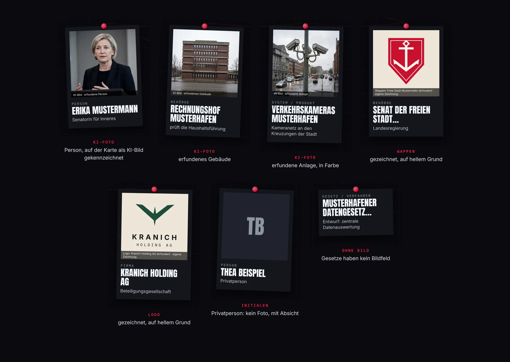

Personen, Firmen, Behörden, Systeme und Gesetze liegen als Karten auf der Wand. Zu jedem Bild gehört ein Nachweis,
der auf der Karte steht: Urheber und Lizenz, in der Demo „KI-Bild · erfundene Person“. Logos und Wappen zeigt die
Akte ganz, auf hellem Grund. Eine Privatperson bekommt kein Foto, und Leser sehen von ihr nur die Initialen.

### Drei Arten von Fäden

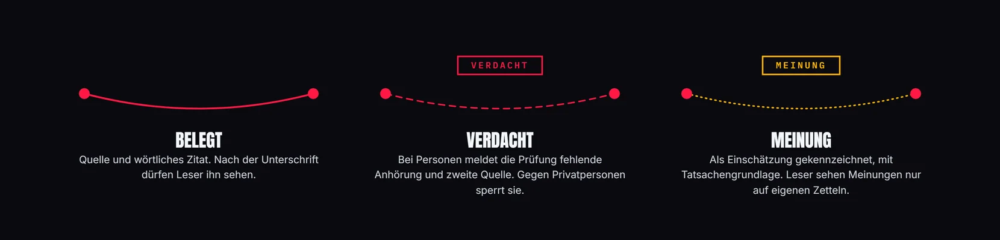

Ein Faden ist eine Aussage mit Art, Zeitraum und mindestens einem Beleg. Wie er aussieht, sagt, was er behauptet.
Bei einem Verdacht gegen eine Person meldet die Prüfung, wenn Anhörung oder zweite unabhängige Quelle fehlen. Gegen
eine Privatperson sperrt sie ihn ganz.

### Jeder Beleg mit Wortlaut und Fundstelle

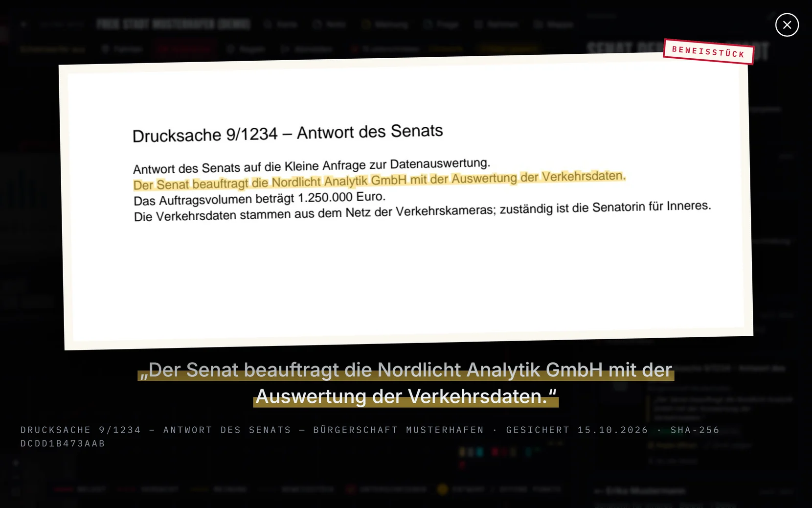

Die Akte sichert jede Quelle mit Prüfsumme und sucht das Zitat selbst in der gesicherten Kopie (gibt es keine, im
Original). Findet sie es, markiert sie die Stelle wie hier. Weicht das Zitat ab, meldet sie `nicht_gefunden`, auch
dem Agenten. Die Demo enthält dafür absichtlich ein Zitat, dem ein Wort fehlt.

### Regeln beraten, du entscheidest

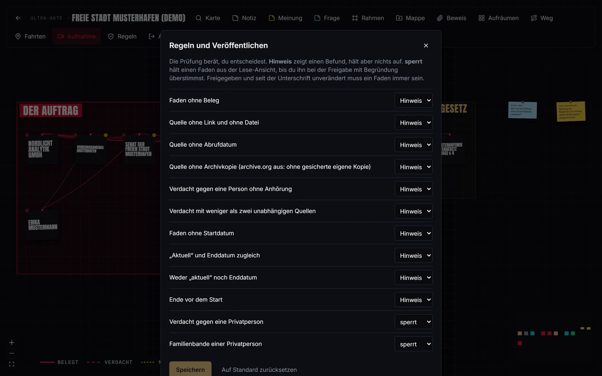

Jede Regel stellst du je Board auf *aus*, *Hinweis* oder *sperrt*. Ein Hinweis zeigt einen Befund und hält nichts
auf. Eine Sperre hält den Faden aus der Lese-Ansicht, bis du sie bei der Freigabe überstimmst, mit Begründung:

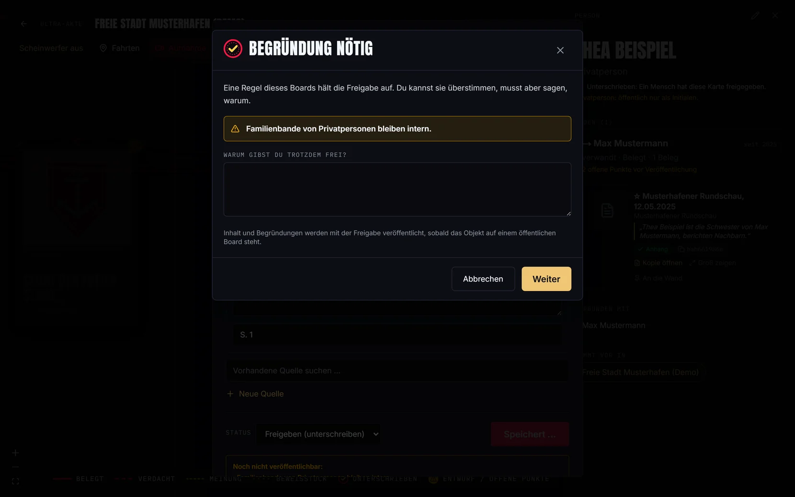

### Leser sehen nur Unterschriebenes

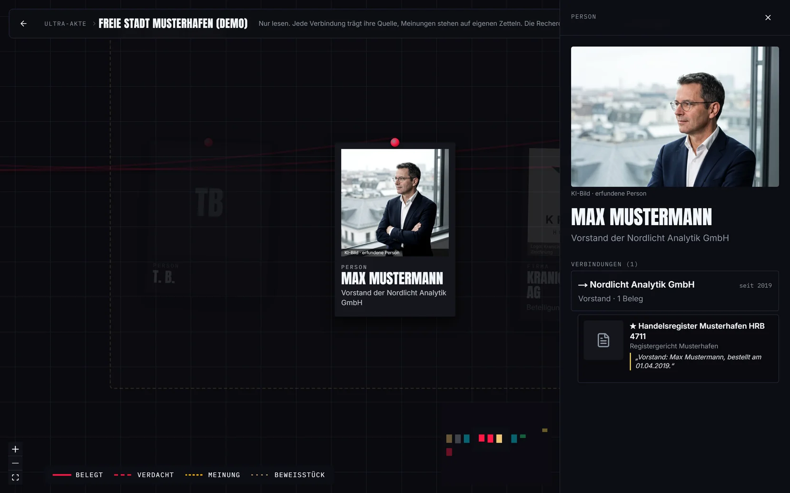

Leser sehen nur Karten und belegte Fäden, die ein Mensch unterschrieben hat und die die Prüfung bestehen. Meinungen
stehen dort auf eigenen Zetteln, Privatpersonen nur mit Initialen. Leser sind Konten mit Lesezugriff und, wenn du ein
Board öffentlich schaltest, alle ohne Anmeldung. Öffentliches Lesen ist ab Werk aus.

### Live auf der Wand

<picture>
  <source media="(prefers-reduced-motion: reduce)" srcset="docs/bilder/readme/live-standbild.webp">
  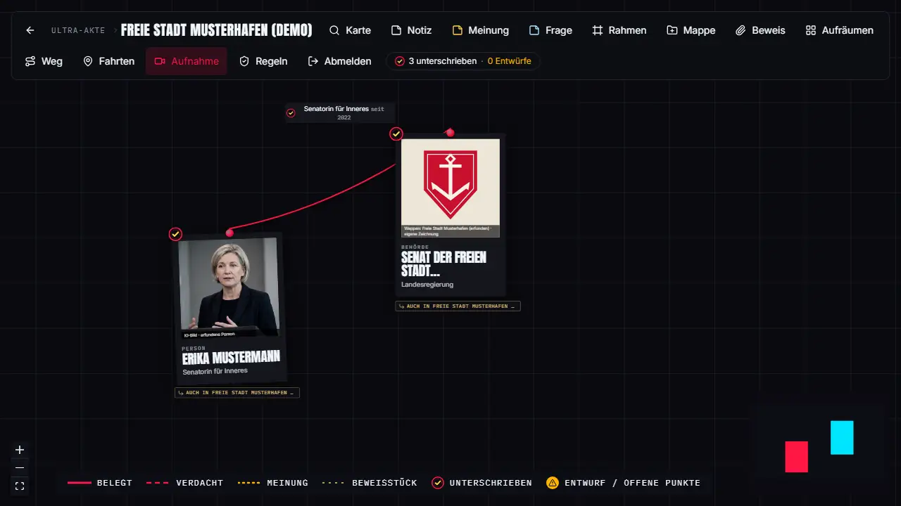
</picture>

Was ein Agent anlegt, erscheint nach wenigen Sekunden auf der offenen Wand, als Entwurf mit dem Stempel „neu“.
Kamera, Auswahl und offene Formulare bleiben, wie sie sind.

<sub>Alle Bildschirmfotos und Animationen dieser Seite erzeugt [`werkzeuge/readme_bilder`](werkzeuge/readme_bilder/README.md) aus der Demo.</sub>

### Unter der Haube

Eine gewöhnliche Datenbank mit drei Schichten darüber:

1. **Regeln im Datenmodell.** Ein Faden zwischen zwei Karten (Personen, Firmen, Behörden, Gesetze …) ist eine
   Aussage: Art der Verbindung, Zeitraum, Aussageart (*belegt*, *Verdacht*, *Meinung*) und Belege – jeweils
   Quelle, **wörtliches Zitat** und Fundstelle. Eine Prüfung meldet, was fehlt: Beleg, Abrufdatum, Archivkopie,
   Anhörung bei Verdacht, Schutz von Privatpersonen. Jede Regel ist einzeln auf *aus*, *Hinweis* oder *Sperre*
   stellbar.
2. **Beweisschicht.** Jede Quelle wird gesichert: Original mit SHA-256, auf Wunsch eine Archivkopie, Seitenbild und
   die **Fundstelle**, also der Ausschnitt mit dem markierten Zitat. Jede Sicherung und jede Freigabe wird ein
   signiertes Glied einer Hash-Kette im Format [`atlas-trace-v1`](https://github.com/ThePyth0nKid/atlas). Prüfen
   kann jeder, ohne dem Server zu vertrauen – mit `akte pruefe-signaturen` oder dem unabhängigen Prüfer von Atlas.
3. **Ausgabeschicht.** Aus derselben Wand entstehen Kamerafahrten bis zum fertigen Video: Bild für Bild
   wiederholbar, in 16:9, 9:16, 1:1, auf Wunsch mit Stimme, Musik und markierten Beweisstücken.

Darüber steht ein **Verfahren**: Recherche-Agenten → unabhängiger Faktenprüfer *vor* dem Import → Import als Entwurf
→ Beweissicherung → Prüfung → **Freigabe durch einen Menschen mit seiner Unterschrift**. Agenten (Werkzeug-Token,
MCP) können nichts freigeben, nichts löschen und nichts öffentlich schalten.

Verwandte Werkzeuge mit anderem Schwerpunkt: [Aleph](https://github.com/alephdata/aleph) (Dokumente und Entitäten
durchsuchen), [Maltego](https://www.maltego.com/) (OSINT-Verknüpfungen), [Kumu](https://kumu.io/) (Netzwerkkarten),
[Hunchly](https://hunch.ly/) (Web-Sicherung). Die Akte verbindet Belegpflicht am einzelnen Faden, signierte
Freigaben und Video-Ausgabe in einem lokalen Programm.

## Mit Claude Code arbeiten (MCP)

Der Starter verbindet Claude Code für dich (`start\AGENT-VERBINDEN` oder `akte.ps1 agent`) und setzt dabei den
richtigen Port ein. Von Hand, im Akte-Ordner, zwei Zeilen. `8080` ist der Standard-Port; hat der Starter einen
anderen gewählt, steht er in `.env` unter `AKTE_PORT` (dann `8080` in der zweiten Zeile ersetzen):

```
docker compose exec api python manage.py akte_token DEIN-KONTO
```

```
claude mcp add --scope user akte -e AKTE_BASIS=http://127.0.0.1:8080 -e AKTE_TOKEN=DEIN-TOKEN -- uvx --python 3.12 --from "https://github.com/ThePyth0nKid/ultra-akte/archive/refs/tags/v0.3.0.zip#subdirectory=mcp" akte-mcp
```

Ohne Token sieht Claude bei einer lokalen Akte nichts. Alles, was ein Agent anlegt, ist ein Entwurf. Werkzeuge und
Arbeitsweise: [docs/mcp.md](docs/mcp.md).

## Beweiskette prüfen – ohne dem Server zu vertrauen

```
uv tool install --python 3.12 "akte-mcp[beweis] @ https://github.com/ThePyth0nKid/ultra-akte/archive/refs/tags/v0.3.0.zip#subdirectory=mcp"
```

```
akte pruefe-signaturen --basis http://localhost:8080 --speichern ./pruefung
```

Geprüft werden Hashes, Ed25519-Signaturen, die lückenlose Reihenfolge, Rollen (Freigaben nur durch Menschen),
Widerrufe und die offengelegten Inhalte. Mit `--atlas` zusätzlich durch den WASM-Prüfer von Atlas. Was eine gültige
Kette beweist und was nicht: [docs/sicherheit.md](docs/sicherheit.md).

<picture>
  <source media="(prefers-reduced-motion: reduce)" srcset="docs/bilder/readme/terminal-standbild.webp">
  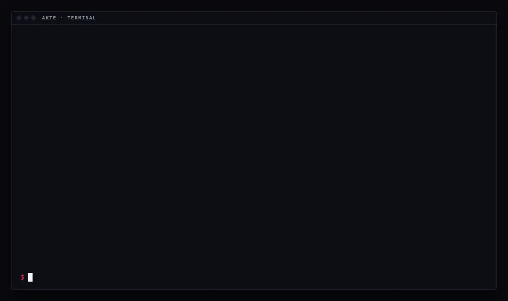
</picture>

## Freigeben heißt unterschreiben

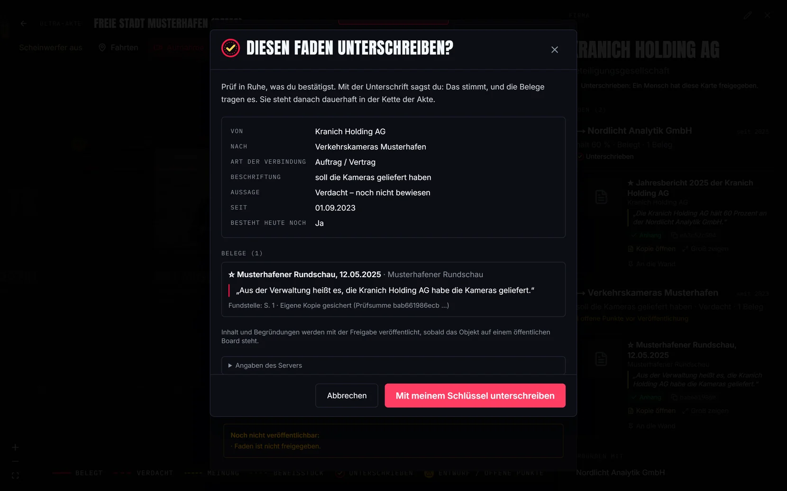

Wählst du in der Oberfläche „Freigeben (unterschreiben)“, erzeugt dein Browser beim ersten Mal ein
Ed25519-Schlüsselpaar. Der private Schlüssel ist nicht exportierbar und verlässt den Browser nie; der Server kennt
nur den öffentlichen. Sperrende Befunde kannst du mit einer Begründung überstimmen – die Begründung wird
mitsigniert und mit dem Objekt veröffentlicht. Änderst du etwas Freigegebenes, wird es wieder Entwurf und braucht
eine neue Unterschrift. Wie streng die Prüfung eines Boards ist, stellst du unter **„Regeln“** ein; dort widerrufst
du auch einen Schlüssel, etwa nach dem Verlust eines Geräts. Ein anderer Browser oder gelöschte Browserdaten
erzeugen still einen neuen Schlüssel; deine alten Unterschriften bleiben gültig. Leser sehen nur, was ein Mensch
unterschrieben hat. Regeln und Stufen: [docs/belegregeln.md](docs/belegregeln.md).

## Videos aus der Wand

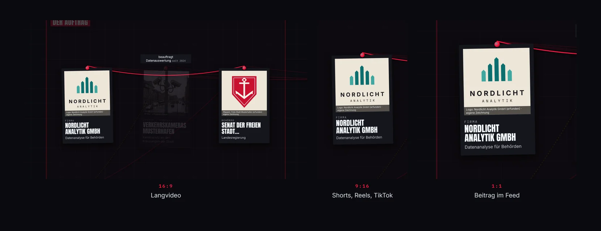

Jedes Format bekommt seinen eigenen Ausschnitt, und Titel bleiben lesbar groß. Einmal einrichten (Node, Python und ffmpeg müssen installiert sein), dann rendern:

```
cd render; npm ci; npx playwright install chromium; cd ..
```

```
python render/aufnahme.py rendern demo-musterhafen "Wer wertet Musterhafens Daten aus?" --format 16x9,9x16
```

Zugangsdaten, Stimme und Musik (ElevenLabs, eigener Schlüssel): [docs/aufnahme.md](docs/aufnahme.md).

## Grenzen

* Die Akte ersetzt **keine anwaltliche Prüfung**. Die Regeln zu Verdacht und Privatpersonen orientieren sich am
  deutschen Presserecht, sind aber Werkzeuge, kein Urteil.
* Eine gültige Signatur beweist, *wer* *wann* *was* unterschrieben hat – nicht, dass es wahr ist.
* Ein Agent kann sicher klingend etwas Falsches behaupten. Prüf die Belege selbst, bevor du unterschreibst.
* Selbst betreiben im Netz: [docs/betrieb.md](docs/betrieb.md) (Proxy, HTTPS, Backups, Browser-Worker).

<details>
<summary>Ohne Docker (für Entwickler)</summary>

```sh
# Backend
cd backend && python -m venv .venv && . .venv/bin/activate      # Windows: .venv\Scripts\activate
pip install -r requirements.txt ../beweis
DJANGO_DEBUG=1 python manage.py migrate && python manage.py createcachetable
DJANGO_DEBUG=1 python manage.py akte_einrichten && DJANGO_DEBUG=1 python manage.py runserver 8000
# Web (zweites Terminal)
cd web && npm ci && AKTE_OHNE_PROXY=1 npm run dev     # http://localhost:3000/akte
```
</details>

## Aufbau

| Ordner | Inhalt | Lizenz |
|---|---|---|
| `start/` | Starter für Windows (`akte.ps1`, `.cmd`) und macOS/Linux (`akte.sh`) | AGPL-3.0 |
| `backend/` | Django-API, Prüfung, Beweissicherung, Beweisschicht | AGPL-3.0 |
| `web/` | Wand (Next.js, React Flow), Unterschrift im Browser | AGPL-3.0 |
| `render/` | Kamerafahrten zu Video, Stimme, Mischung | AGPL-3.0 |
| `mcp/` | `akte-mcp`, Python-Client, CLI `akte` | MIT |
| `beweis/` | `akte-beweis`: Atlas-Format, Prüfung, Richtlinie | MIT |
| `skills/` | Skill für Claude Code: an der Akte arbeiten | MIT |
| `werkzeuge/` | Leckschutz-Prüfer, Bilder dieser README, Hilfsskripte | MIT |
| `docs/`, `AGENTS.md` | Anleitungen | CC BY 4.0 |

## Mitmachen

Fehler und Ideen gern als Issue. Sicherheitslücken bitte vertraulich melden: [SECURITY.md](SECURITY.md).
Beiträge: [CONTRIBUTING.md](CONTRIBUTING.md).

Lizenz: AGPL-3.0-or-later für das Programm; Teile unter MIT und CC BY 4.0 wie oben (siehe `REUSE.toml`).
Wer die Akte im Netz für andere betreibt, muss ihnen den Quelltext anbieten (AGPL § 13) – der Link steht schon unten
auf der Board-Übersicht.
